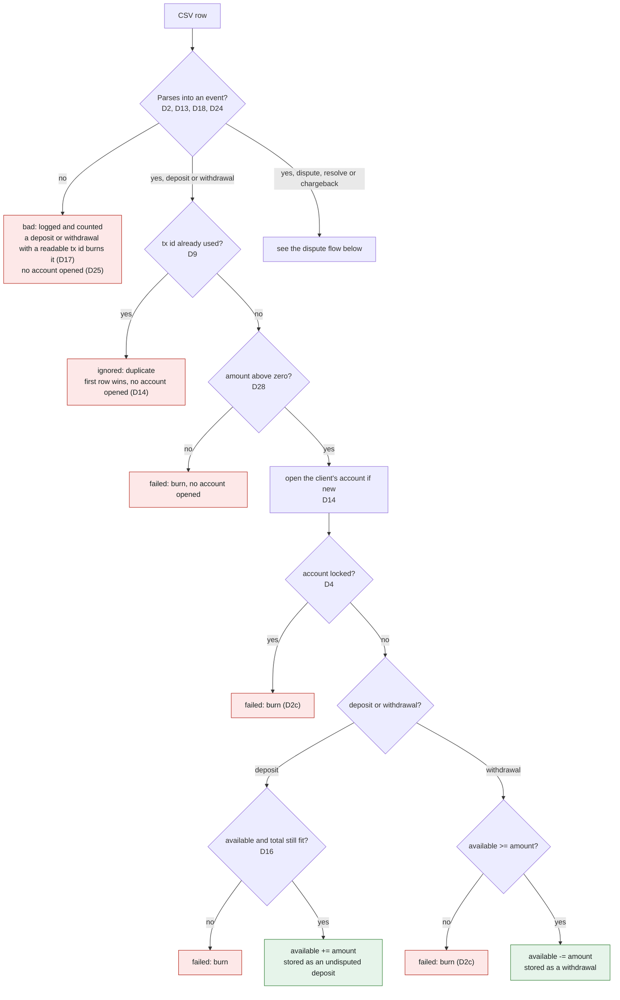
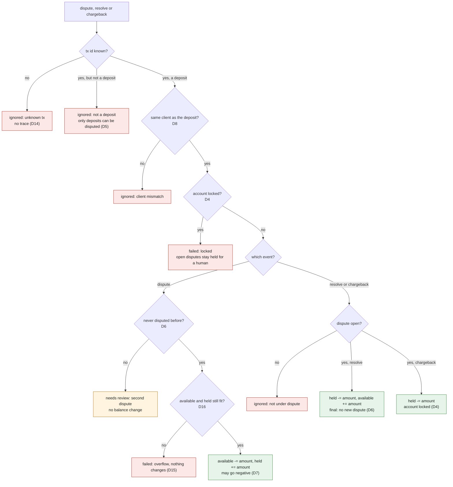

# Decisions

Policies are the engineer's. Each row: what we do, why (engineer's words), rejected options. Status UNVERIFIED means a fact or assumption not yet run.

## D1 CSV layer
- **Do:** `csv` crate only, no serde. Rows become typed values by our own field parsing.
- **Why:** I can rely on typed rows for error matching and type safety enforced, instead of parsing strings.
- **Rejected:** `csv` + serde derive (field errors arrive as strings); no crates (we would own quoting, CRLF, BOM).
- **Verified in a scratch crate (csv 1.4.0):** a BOM is stripped from the header; CRLF, tabs around fields and quoted fields are handled with trim on; blank lines are skipped; dependencies are csv-core, memchr, itoa, ryu and serde_core. See [D18](#d18-csv-reader-settings-f4) for the row-length and UTF-8 findings.
- **Verified (scratch crate):** with headers off a BOM on the first line is still stripped, so header detection ([D19](#d19-header-f12)) sees a clean first field. The crate's reported line number is unreliable (it gave line 1 for a record on line 3 after blank lines, and for the second record of a CRLF file), so "row N" in our errors means the Nth record counted by us.

## D2 Amount format
- **Do:** lenient parse into whole ten-thousandths. Accept `1.` and `.5`. No sign accepted. More than 4 places, `1e3`, `1,5`, NaN, empty and overflow are rejected.
- **Why:** We can be lenient, a sign is not needed as the action is inferred from the deposit / withdrawal type, so we accept different formats to be a bit more robust. We state this in the design and in the guidelines for the CSV upload format.
- **Rejected:** strict (only digits and one optional fraction); a decimal crate.
- **UNVERIFIED:** my reading that "no sign needed" means `+1` stays rejected; whether the scorer ever sends `.5` or `1.`.

## D2b Zero amount
- **Do:** a deposit or withdrawal of 0 is rejected and logged.
- **Why:** It does not move money and can be used to lock an account unnecessarily. We can consider it an error because it does not make logical sense.
- **Rejected:** accept zero as a no-op; accept zero but make it not disputable.
- **Evidence:** a zero deposit, disputed then charged back, locked the account and blocked a later real deposit of 10.

## D2c Rejected rows burn their tx id
- **Do:** every rejected deposit or withdrawal row whose tx id parsed records that id as used. A later row with the same id is refused.
- **Why:** Every rejected row is added to the transactions already processed and cannot be replayed. The partner should create a new tx, so our system stays idempotent and we cannot reapply a withdrawal twice with different outcomes. A row cannot be edited and still accepted because it had different properties.
- **Rejected:** burn only invalid-content rows (a failed withdrawal could be retried); burn nothing.
- **UNVERIFIED:** scope is deposit and withdrawal rows only; dispute, resolve and chargeback rows reference an existing id and burn nothing.

- **Locked accounts:** a deposit or withdrawal refused because the account is locked burns its id too.
- **Why (locked):** A tx id is used once, and a retry needs a new id to stay idempotent.
- **Left for the review agent:** the engine takes any `Amount` in a deposit or withdrawal; only the parser makes sure it is positive.

## D3 Bad rows and exit code
- **Do:** log skipped rows (row number, field, category; never the raw text) up to one shared cap of 100 lines, then count per reason (bad, failed, ignored, needs review) and print the counts at the end, so review errors always show as a count ([D20](#d20-log-cap-and-counts-f10)). Refusals from the engine carry their row number too (`row N: ...`). Exit 0 if the file was read; exit 1 only for open, read or write failure; exit 2 unless exactly one input path is given ([D21](#d21-arguments-and-read-failures-f14)).
- **Why:** 100 rows is enough to diagnose the issue causing skipped rows and see the pattern. If the system scales it is better to raise it; for this design constraint 100 is fine.
- **Rejected:** log 1000; exit non-zero when any row was skipped.
- **Evidence:** about 52 MB of stderr per million bad rows if all logged, about 5 KB at cap 100.
- **UNVERIFIED:** how the automatic scorer treats a non-zero exit.

## D4 Locked account
- **Do:** after a chargeback, the account accepts no automatic events: no deposit, withdrawal, dispute, resolve or chargeback.
- **Why:** On a frozen account we block so that a human can review and manually resolve. We do not allow any more automatic events on the account. It is safer for us and avoids fraudulent transactions or illicit behaviour.
- **Rejected:** block deposits and withdrawals only; set the flag and process everything.
- **Consequence:** other open disputes on a locked account stay open until a human acts.

## D5 Which transactions can be disputed
- **Do:** deposits only. A dispute that names a withdrawal id is ignored and logged.
- **Why:** It does not make sense to dispute a withdrawal: for a chargeback on a withdrawal the client would send money back to us, but we have no control over that, only over the funds in their account in our system, so it does not fit the intro of the doc. The risk is with a deposit that is reversed after they actually spent the funds; the bank allows them to reverse the payment, and then we are exposed to fraud and losses. It does not make sense to hold an amount for a withdrawal that already left the account; a deposit on the other hand does, since it holds the funds until we can clarify. Same for a chargeback: what are they receiving, our money? A free money glitch. Also, after funds are withdrawn our system cannot do anything in terms of anti financial crime (maybe stop other withdrawals), but a dispute on a deposit already does that.
- **Rejected:** deposits and withdrawals; withdrawals only.
- **Evidence:** deposit 10, withdraw 4, dispute the withdrawal, chargeback: total ends 2 instead of 6 (the client is debited twice).

## D6 One dispute per transaction
- **Do:** a transaction can be disputed once, ever. A second dispute (while open, or after a resolve) changes no balance and is reported as an error for human review. Handling is idempotent. Charged back and resolved are final.
- **Why:** One dispute per transaction avoids duplicate replays of disputes. The second is an error action and needs human review. One claim is one payment back for it in our logic.
- **Rejected:** allow a re-dispute after a resolve.
- **UNVERIFIED:** "human review" means a distinct error on stderr, not an account lock.

## D7 Negative available balance
- **Do:** a dispute may take available below zero (signed balances). The chargeback still applies and locks the account. No extra lock on a negative dispute.
- **Why:** Available decreases by the disputed amount, so a negative balance is possible and should show once disputed, so the human reviewing the chargeback claim sees that the outcome is a negative balance. The negative total tells the reviewer we will make a loss on that account and that it could be a deposit, use, dispute and withdrawal fraud. Only a chargeback locks.
- **Rejected:** ignore a dispute that would go negative; hold only the available part.
- **Evidence:** deposit 10, withdraw 8, dispute the deposit: available -8, held 10; after chargeback total -8.

## D8 Client mismatch
- **Do:** a dispute, resolve or chargeback from a client that does not own the transaction is ignored and logged, the same as an unknown tx.
- **Why:** A client can only dispute their own transaction. Otherwise it would be chaotic if client B could freeze client A's funds with A's tx id. Even if an id leaks, clients must not be able to act on other accounts. We treat it as a mismatch or partner error, the same for resolves and chargebacks.
- **Rejected:** apply to the owner; apply to the sender.

## D9 Duplicate or reused tx id
- **Do:** a duplicate id, including a deposit that reuses a withdrawal's id, is ignored and logged. The first row wins.
- **Why:** Tx ids are globally unique, so a reuse or duplicate id is a partner error and can be logged.
- **Rejected:** trust uniqueness and check deposits only; a separate set for withdrawal ids.
- **Evidence:** with deposits checked only, a reused id was credited (available 13 instead of 6).

## D10 Memory for tracked ids
- **Do:** one `HashMap<u32, Entry>` holding every id used and what it was used for: a deposit (owner, amount, dispute state), a withdrawal, or a rejected row. The README states the maximum number of transactions this design can hold.
- **Why:** Only one map is needed to keep track of ids used and what they were used for. It is easiest to review and it covers disputes. We can use it to state the limitation of this design. A section on future options can argue for a bitset and a dispute window for larger systems, depending on how users use or abuse the system. We do not want to over-design if it is not necessary.
- **Rejected:** bitset of ids plus a deposit map; a hard entry limit that stops the run.
- **Measured (release build, input piped from the seeded generator `gen <rows> 1 1000`, no file on disk):** `Entry` is 16 bytes (compile-time assert), so a stored id takes 24 bytes plus one control byte per table slot. Peak memory steps up each time the table doubles: 27 MB at 0.42M stored ids, 101 MB at 1.7M, 202 MB at 2.5M to 3.4M, 402 MB at 4.2M to 5.9M, and 761 MB at 8.5M ids (10^7 rows, 4.6 s, about 2.2M rows per second). With 65,535 clients at 10^7 rows the peak is 844 MB. The generator itself peaks at 1.5 MB, so the reader and the pipe are flat and the growth is the id map.
- **Reading the numbers:** that is 68 to 95 bytes per stored id at the peak, about 1.3 times what a 25-byte slot plus the copy during a table doubling predicts. The extra was not investigated, UNVERIFIED.
- **Extrapolation, UNVERIFIED:** about 7 to 9 GB for 10^8 stored ids, and roughly 300 to 400 GB if all 2^32 ids were used. The README states this as the limit of this design.

## D11 Shape
- **Do:** synchronous. Parse a row into an event, `apply(engine, event)` returns a result, then write. The reader is generic over `Read`. Async and sharding are described only in the README.
- **Why:** Async helps for speed, but using it in the right place matters more, and keeping the process simple is even better because it is easy to maintain. For one ordered file, synchronous is correct and fast enough. To scale, rows can be parsed in parallel, the tx id check stays in one ordered store, then work is sharded by client so clients run in parallel while each client's events stay in order. Splitting parse, apply and output shows where an error comes from: parsing turns the input into clean internal types, the rules work only on transaction events and can be tested with events alone, and the outcome is written last. It is also easier to maintain: a different file type, a stream, gRPC or an API only needs to be turned into the same events; from then on they are transaction events, not files or parsing. A processor trait would add nothing we needed: with one engine there is nothing to swap. A stack of traits can hide what the code wants to accomplish and gives a reviewer more context to take in, while keeping it simple lets them follow the code flow to the intent. Generics earn their place where there really are two implementations, like `Read` and `Write` (a file in `main`, bytes in tests). A trait can still be added later, when a second engine appears.
- **Rejected:** one loop doing everything; trait-based processors.

## D12 Output
- **Do:** rows sorted by client id; every amount printed with exactly four decimals (`0.0001`, `-0.0500`, `-8.0000`).
- **Why:** Four places is the same precision as the input, and sorting makes every run identical and easy to compare byte for byte, and to test the padding edge cases `0.0001` and `-0.0500`.
- **Rejected:** trimmed zeros; hash order.

## D13 Type column case
- **Do:** accept any case after trimming, matched with `eq_ignore_ascii_case` against each name. No lowercase copy is allocated.
- **Why:** Be lenient: if the text matches once lowercased, do not risk losing deposits that should be allocated, and lose money.
- **Rejected:** lowercase only.

## Design review outcomes (Opus attack, answered)
Findings F1 to F15 came from a read-only review of the design and test plan. Each was answered by the engineer. "Approved as proposed" means the engineer agreed with the fix or acceptance as written.

## D14 When an account exists (F5)
- **Do:** a deposit or withdrawal row opens the client's account when it reaches the balance checks, even if it then fails there (locked, insufficient funds, overflow). A row refused as a duplicate tx id opens no account. Dispute, resolve and chargeback rows for an unknown client leave no trace.
- **Why:** If a client does not exist we create a new record, so a deposit or withdrawal row that reaches the balance checks opens it even if it fails. A duplicate id is a partner error, so it leaves no trace. Disputes, resolves and chargebacks for unknown clients leave no trace. I disagree with this part of the brief and would prefer an onboarding process, especially for clients using our system: be strict with what we receive from clients and lenient with trusted upstream partners, and our partner docs could say a dispute is only processed if the deposit exists. Financial data should keep state, especially to track how something is gamed or misused, but with a limited scope and clear boundaries, so the data still makes sense instead of accepting junk or an invalid position just because the system allows it. I would rather design so the data always makes sense, which is easier to interpret and explain. A dispute needs a valid deposit even if it takes the account negative; that can then be investigated and resolved. We should not take a financial loss because of a partner integration error or a customer trying fraudulent behaviour.
- **Rejected:** open only after an accepted deposit; open on any row naming the client; open the account before the duplicate check (the first version did this).
- **Meaning of "no trace":** no account, balance or id change, but the refused row is logged and counted as ignored ([D9](#d9-duplicate-or-reused-tx-id), [D20](#d20-log-cap-and-counts-f10)).
- **Tests:** engine rows for a duplicate deposit and a duplicate withdrawal from a new client; run table; data pair 8.

## D15 A rejected event changes nothing (F1, F6, F7)
- **Do:** a rejected event changes no balance, no dispute state and no lock. A dispute computes both new values (available, held) and then stores both. Recording a rejected id never replaces an existing entry (first row wins; use the map's entry API, not insert).
- **Why:** A rejected row must leave no trace, and replays must not give different results.
- **Tests:** duplicate deposit then dispute still holds the original; a wrong-client dispute does not use up the one-dispute rule; an overflowing dispute leaves available and held untouched.

## D16 Overflow (F3, F8)
- **Do:** a deposit is rejected, and its id burned, if available + held + amount would no longer fit in `i64`. With that kept true, a resolve or chargeback cannot overflow; a dispute still uses checked arithmetic. Display uses the absolute value as unsigned so the minimum `i64` prints.
- **Why:** A total we cannot print is worse than a refused deposit, so the deposit fails.
- **Tests:** the maximum amount, dispute, then a 0.0001 deposit is rejected; display of minimum and maximum.
- **If the rule ever breaks (U1):** `Account::total()` returns an `Option` from a checked add, and a total that does not fit ends the run with an error (exit 1) instead of printing a clamped number. `write_accounts` checks every account's total before it writes the header or any row, so nothing partial is written.
- **Why (U1):** If the rule above ever breaks, the program must not print a clamped wrong number. A total we cannot print should fail the run.
- **Tests (U1):** `account_total_table` (engine) and `total_overflow_is_an_error_and_writes_nothing` (output), the second with the broken account first, last and alone.

## D17 Burning ids of rows that fail to parse (F2)
- **Do:** the tx field is parsed on its own. A row of type deposit or withdrawal that fails on any other field returns an error that carries the tx id and the row kind, and the engine gets a call to burn that id. Other row types burn nothing.
- **Why:** A bad amount must not free the tx id for a second try. This is what makes [D2c](#d2c-rejected-rows-burn-their-tx-id) true for bad amounts, bad clients and zero amounts.
- **Tests:** data file with a bad amount followed by the same id with a good amount (second refused).

## D18 CSV reader settings (F4)
- **Do:** flexible row lengths, byte records, trim all, quoting off. Only an I/O error ends the run (exit 1); a short row or a field that is not UTF-8 is a row error. A quote is an ordinary character.
- **Why:** One bad row must not stop the whole file. The crate was run in a scratch folder first.
- **Why (quoting off):** Turn csv quoting off, so a stray quote makes only that row bad and every other row still parses. With quoting on, one stray opening quote swallowed every later row and the run still exited 0 with a partial result.
- **Rejected (quoting):** keep quoting and end the run on an unterminated quote.
- **Tests:** a stray-quote row and a data pair; quoted fields are now literal, so the old quoted-fields row expects a rejected row.
- **Verified (csv 1.4.0, scratch crate):** with flexible off, a 3-field row is an error and the reader moves on to the next row; with flexible on, 3-field and 4-field rows both read; byte records return a bad-UTF-8 field without an error, so the conversion is ours and becomes a row error; an empty file gives an empty header and no rows; with headers on, a file without a header loses its first row.

## D19 Header (F12)
- **Do:** detect the header. If line 1 is not a header, warn and parse it as data, so we never lose a row. The output always starts with its header line, even for empty input.
- **Why:** Detect the header so we never lose a row.
- **Header means:** the first record's four names match type, client, tx, amount, ignoring case after trim (agreed). The reader runs with headers off and the check is ours (BOM, trim and case verified in a scratch crate).
- **Rejected:** always treat line 1 as the header.

## D20 Log cap and counts (F10)
- **Do:** one shared cap of 100 logged lines. After it, count per reason (bad, failed, ignored, needs review) and print those counts at the end, so review errors always show as a count.
- **Why:** Review errors always show as a count, even behind a flood of junk rows.
- **Rejected:** a separate cap per category; never capping review errors; accepting the loss.

## D21 Arguments and read failures (F14)
- **Do:** exit 2 unless exactly one path is given. A read failure mid-file writes nothing and exits 1, so a partial result is not mistaken for a full one. Failures writing to stderr are ignored, never a panic.
- **Why:** Exit 2 unless exactly one path; write nothing on a mid-file failure so a partial result is not mistaken for a full one.
- **Rejected:** ignore extra arguments; write the partial result.

## D22 Output format (smaller gap)
- **Do:** header `client,available,held,total,locked`; no spaces; locked printed as `true` or `false`.
- **Why:** Fix the output format in the design.

## D23 No cap on field length
- **Do:** no limit on the length of a single field or record for now. The limit is stated in the README (engineer writes it).
- **Why:** Document it as a limit and add no cap per ticket for now.
- **Measured (final review, quoting on at the time):** one row `deposit,1,1,5` followed by 10^8 commas used 1.6 GB (16 times the input); one 10^8-byte amount field used 254 MB (2.5 times). An endless single field (`/dev/zero` as input) grows until the operating system stops the process, with no exit code 1, UNVERIFIED. A real fix later would be a capped reader that ends the run when a line passes N bytes. The README states this as a limit.

## D24 Field count is checked first
- **Do:** a row with a non-empty value after the fourth field reports too-many-fields before any field error, and the tx id still burns when the row is a deposit or withdrawal whose tx parsed. An unknown type with extra fields reports too-many-fields and burns nothing. Empty fields after the fourth are tolerated, so `deposit,1,1,1.0,` still parses; the header line is read the same way.
- **Why:** The whole row is broken, so we report that, and tx 5 still burns.
- **Why (empty fields):** An empty fifth field is tolerated, so `deposit,1,1,1.0,` still parses; a non-empty fifth field still triggers too-many-fields. Without this, a file whose every line ends with a comma would be rejected row by row.
- **Rejected:** field errors first (the first implementation did this; no test pinned the order).
- **Tests:** three rows in the parse table (bad client, bad amount, unknown type, each with a fifth field) and two in the burn table; empty fifth and sixth fields, a value after an empty field, a header with a trailing comma, and a data pair where every line ends with a comma.

## D25 Engine edge points
- **Do:** (a) one `Locked` error covers all five event types on a locked account; (b) a row that fails to parse burns its id but opens no account; (c) the error categories (bad, failed, ignored, needs review) are mapped in the output ticket, not in the engine.
- **Why:** A row that fails to parse burns its id but opens no account. The other two points were agreed as written.
- **Rejected:** opening an account from a row that failed to parse (the client may not be readable).
- **Consequence:** for `deposit,7,1,abc` client 7 has no record, while `withdrawal,7,1,5` with no funds does ([D14](#d14-when-an-account-exists-f5)).

## D26 Independent edge check (t-05)
- **Do:** no engine change. Three data pairs added (withdrawal for an unknown client, exact decimal sums, extreme ids), pair count 21 to 24.
- **What was checked:** a fresh reviewer, who had only the task description and none of our code or docs, wrote 52 edge inputs outside the repo. 33 had an output fixed by the task description and all 33 match. 19 were left open by the task description; every output is one of the reviewer's listed readings.
- **Where we differ from the reviewer's most likely reading:** (a) a withdrawal that fails for a client with no account still opens a zero account ([D14](#d14-when-an-account-exists-f5)); (b) a deposit cannot be disputed a second time, even after a resolve ([D6](#d6-one-dispute-per-transaction)); (c) a locked account refuses disputes and resolves too, so another open dispute stays held for a human ([D4](#d4-locked-account)).
- **Why:** these three follow the engineer's earlier decisions and the reasons recorded there; the check confirms they are consequences of those decisions, not accidents.
- **Not in the repo:** the reviewer's files and notes stay outside it, because they were written from the task description.

## D27 Accepted after the final review
- **Do:** no change for these findings; the numbers or notes go in the README where marked.
- **Why:** The reviewer's findings are right, but each is either a limit of this simple design, an input contract, or not worth the code now.
- **F7 field size:** accepted under [D23](#d23-no-cap-on-field-length), numbers recorded there.
- **F8 allocations per row:** about three heap allocations per row inside the csv iterator and two hash lookups per deposit. The speed gain of removing them is not measured, so no change.
- **F9, F10 scale:** the id map could be packed smaller, and one engine per stream cannot be sharded without a shared id map ([D9](#d9-duplicate-or-reused-tx-id) needs ids unique across clients). README notes for the scaling section, not code.
- **F11 closed stdout:** `>&-` still exits 0 because the standard library reopens a closed descriptor 1 as `/dev/null`. A pipe whose reader is gone gives exit 1 (tested). One line in the README.
- **F12 skipped counts on a write failure:** if writing stdout fails the run ends with `error: ...` and the skip counts are not printed.
- **F13 lookup duplicated between dispute and resolve/chargeback:** left as is; the two paths are short and tested.
- **F15 file changed while read:** the input must not change during a run. README note.
- **F6 wording in tracked files:** the engineer keeps the current wording.
- **F14 trailing commas:** handled by changing [D24](#d24-field-count-is-checked-first) instead (empty trailing fields are tolerated).

## D28 The engine refuses amounts that are not positive (F2)
- **Do:** `deposit` and `withdraw` refuse an amount that is zero or negative with `NonPositive`, after the duplicate check: the id is burned and no account is opened. The category is failed. The parser already rejects zero and signs, so the CLI never reaches this; it protects the public library API.
- **Why:** Approved as recommended after the final review. Through the library a negative withdrawal raised the balance and a negative deposit followed by a dispute left `held` negative.
- **Rejected:** making every library export except `run` private instead.
- **Tests:** three engine rows (negative deposit then a retry then a dispute, zero deposit, negative withdrawal then a retry) and the category table.

## Think further (not built)
This is a CLI over one file, so std and `csv` are enough. What changes depends on the context: how long we have to build it, the expected load, whether parsing speed or accuracy matters more, how much memory the instance has (and whether it scales up and down), and whether latency can be higher so we can afford a database read to persist data instead of keeping it in memory.

| If we needed | Likely crate | Why not here |
|---|---|---|
| typed rows from CSV with less code | `serde` derive with `csv` | [D1](#d1-csv-layer): field-by-field parsing keeps the tx id when the amount is bad ([D17](#d17-burning-ids-of-rows-that-fail-to-parse-f2)) and gives typed errors per field |
| an async driver for many streams | `tokio`, with bounded channels | one ordered file; [D11](#d11-shape) |
| events arriving over an API or gRPC | `axum` (HTTP) or `tonic` (gRPC) | input is a file passed as a CLI argument |
| persisted state instead of the in-memory map | `sqlx` with Postgres | no crash recovery or restart is asked for; memory measured in [D10](#d10-memory-for-tracked-ids) |
| CLI arguments | `clap` | one positional path; `main` checks it in a few lines |
| library errors with less boilerplate | `thiserror` | three small hand-written enums |
| structured logs and metrics | `tracing` | stderr lines with a cap ([D3](#d3-bad-rows-and-exit-code), [D20](#d20-log-cap-and-counts-f10)) |
| decimal maths with rounding modes | `rust_decimal` | four fixed places, no rounding needed ([D2](#d2-amount-format)) |

## Accepted without change
- **F9 (locked account with another dispute open):** the rule stays; the held funds stay held for a human. A data file pins it. A resolve after a chargeback is ignored (the tx is final and the account is locked).
- **F11 (invariants that cannot fail):** accepted. No random-operation test; multi-event table cases (double resolve, chargeback after resolve, two disputes then one chargeback) are added to the engine tables.
- **F13 (parser strings):** added to the t-01 table (`.`, `-0`, `+0`, `0.0000`, `1.50000`, long runs of leading zeros, a tab and a non-breaking space inside the field). `1.50000` stays rejected.
- **F15 (flood of burned ids):** accepted. The id space is bounded by u32; the README reports the measured entry size.

## Decision flow
The checks run in this order (`parse.rs`, then `Engine::apply` in `engine.rs`). Each box names the decision behind it. "Burn" means the tx id is recorded as used, so a retry needs a new id.

### Every row, and deposits and withdrawals

Decisions in this diagram: [D2](#d2-amount-format) · [D13](#d13-type-column-case) · [D18](#d18-csv-reader-settings-f4) · [D24](#d24-field-count-is-checked-first) · [D17](#d17-burning-ids-of-rows-that-fail-to-parse-f2) · [D25](#d25-engine-edge-points) · [D9](#d9-duplicate-or-reused-tx-id) · [D14](#d14-when-an-account-exists-f5) · [D28](#d28-the-engine-refuses-amounts-that-are-not-positive-f2) · [D4](#d4-locked-account) · [D2c](#d2c-rejected-rows-burn-their-tx-id) · [D16](#d16-overflow-f3-f8)

### Disputes, resolves and chargebacks

Decisions in this diagram: [D14](#d14-when-an-account-exists-f5) · [D5](#d5-which-transactions-can-be-disputed) · [D8](#d8-client-mismatch) · [D4](#d4-locked-account) · [D6](#d6-one-dispute-per-transaction) · [D16](#d16-overflow-f3-f8) · [D15](#d15-a-rejected-event-changes-nothing-f1-f6-f7) · [D7](#d7-negative-available-balance)
Every refused event changes no balance, no dispute state and no lock ([D15](#d15-a-rejected-event-changes-nothing-f1-f6-f7)). Categories on stderr: bad, failed, ignored, needs review ([D20](#d20-log-cap-and-counts-f10)).
