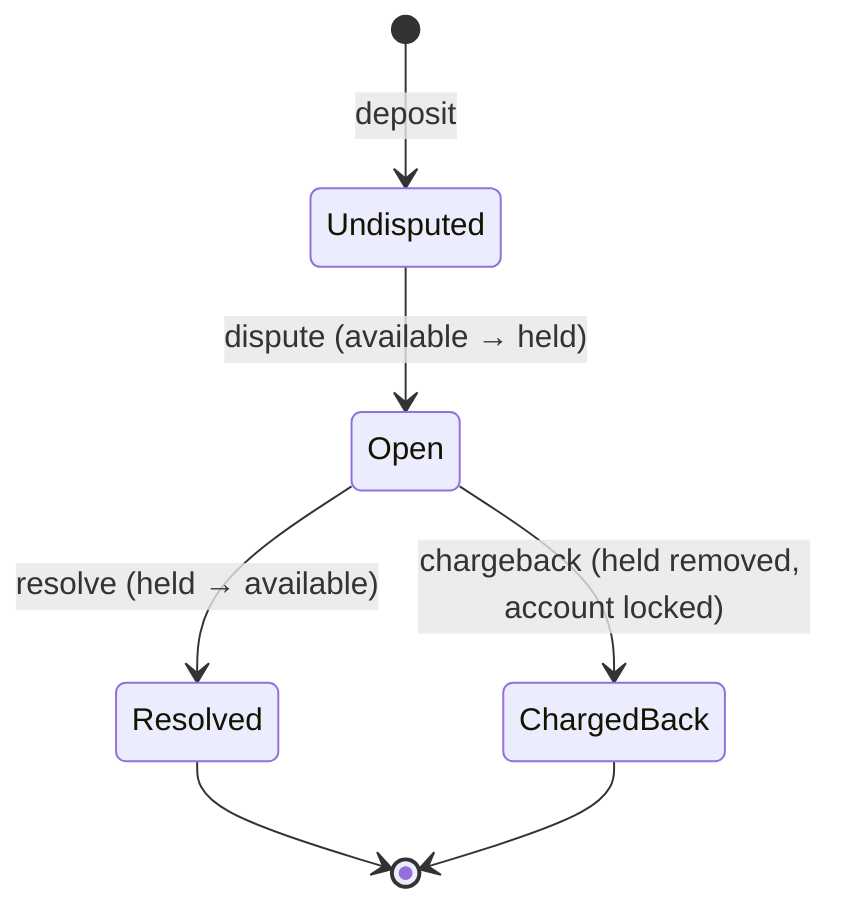

# payments-engine

Reads a CSV of transactions (deposit, withdrawal, dispute, resolve, chargeback) and prints each client's account as CSV.

## Run

```
cargo run --release -- transactions.csv > accounts.csv
```

- stdout: only the accounts CSV, `client,available,held,total,locked`, four decimal places, sorted by client.
- stderr: skipped rows, the first 100 in detail, then one count per reason, so a bad file can't flood stderr.
- Exit codes: `0` finished, `1` I/O failure, `2` not exactly one input path.

Try it on a sample: `cargo run -- tests/data/basic.in.csv`.

## Test

```
./check.sh   # fmt, clippy -D warnings, tests, docs, cargo audit (CI runs the same)
```

| Layer            | Checks                                                      |
| ---------------- | ----------------------------------------------------------- |
| Tables in `src/` | amount parsing, row parsing, every engine rule by name      |
| `tests/data/`    | whole files in, expected output worked out by hand          |
| `tests/cli.rs`   | the real binary: exit codes, closed stdout, stdout only CSV |

## Design

- Input `csv row -> parse -> Event -> Engine::apply -> sorted output`.
- Money is an `i64` count of ten-thousandths: four decimal places stored as a whole number, so our sums are exact (no float drift) and every change uses checked arithmetic.
- Our `Engine::apply` has no I/O and holds all the rules; the CSV layer only parses.
- Modules are declared in `lib.rs`; `main.rs` is a thin binary over the library.

## Assumptions

Each assumed edge case has a test; the reasons and rejected options are in [DECISIONS.md](DECISIONS.md).

- A deposit or withdrawal that reaches the balance check opens the client's record, even if it then fails (a withdrawal without funds). Rows refused before that (duplicate id, bad or non-positive amount) open nothing. Disputes for unknown clients are treated as partner errors and leave no trace.
- Only deposits can be disputed, only by their owner, and only once.
- A chargeback locks the account; a locked account ignores every later row until a human looks.
- A dispute after the money was spent can take available below zero; the negative total shows the loss.
- Amounts accept `1.` and `.5`; no `+` or `-`, at most four places, zero rejected. Type names ignore case.
- A tx id is used once. A reused id is ignored and logged, and a refused deposit or withdrawal (bad amount, no funds, locked account) still uses up its id, so a retry needs a new id.
- Fields are not quoted: a stray `"` makes only its own row bad. Empty fields after the fourth (a trailing comma) are ignored; a non-empty fifth field rejects the row.
- If line 1 is not the header, it is read as data and a warning is logged.

A deposit's dispute lifecycle:



## Limits

- Memory grows with every stored tx id (one map entry each): about 70-95 bytes per id at peak, so 16 GB holds roughly 170-230M ids. The full `u32` id space would not fit in RAM. A bitset for used ids is the upgrade path.
- No cap on a single huge field or row; the csv reader buffers it whole (one row of 10^8 commas peaked at 1.6 GB).
- A failure mid-file (read error, or a total that doesn't fit) writes no accounts and exits 1, so a partial result never looks complete.
- Running with stdout closed (`>&-`) exits 0: Rust reopens a closed stdout before `main` runs, so the write succeeds into nothing.

## Numbers

Release build on macOS, input piped from the seeded generator (1000 clients):

| Rows       | Distinct ids stored | Time      | Peak memory |
| ---------- | ------------------- | --------- | ----------- |
| 1,000,000  | 0.85M               | 0.36 s    | 52 MB       |
| 5,000,000  | 4.2M                | 2.2 s     | 402 MB      |
| 10,000,000 | 8.5M                | 4.6-5.0 s | 760-840 MB  |

With 65,535 clients at 10M rows the peak is 844 MB.

```
cargo build --release --example gen
target/release/examples/gen 10000000 9 1000 | /usr/bin/time -l target/release/payments-engine /dev/stdin > /dev/null
```

## Scaling (not built)

`Engine::apply` is pure, so scaling changes the driver, not the rules. For many TCP streams, `tokio` tasks would feed shards over bounded channels and reject rows when a channel is full. Sharding by client alone would break the global tx-id check, so ids are checked in one shared store first, then the row goes to its client's shard. For memory: a bitset for used ids (512 MiB fixed) or a dispute window that drops old deposits.

## More

[DESIGN.md](DESIGN.md) · [PLAN.md](PLAN.md) · [DECISIONS.md](DECISIONS.md) · [AI_USAGE.md](AI_USAGE.md)
