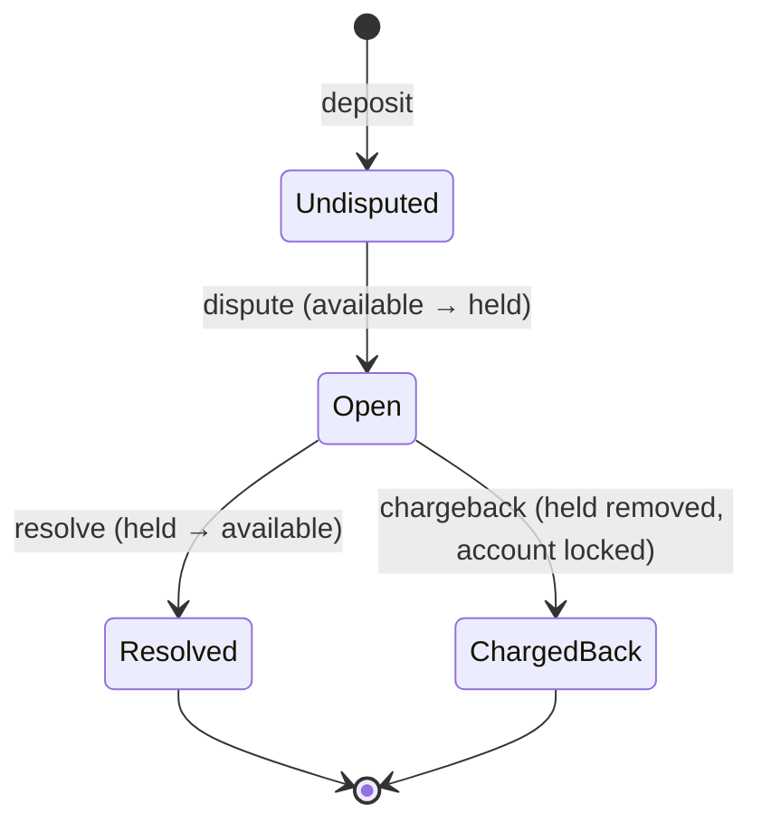

# payments-engine

Reads a CSV of transactions (deposit, withdrawal, dispute, resolve, chargeback) and prints each client's account as CSV.

## Run

```
cargo run --release -- transactions.csv > accounts.csv
```

```
cargo run --release --example gen -- 1000 1 10 > transactions.csv
```

- stdout: only the accounts CSV, `client,available,held,total,locked`, four decimal places, sorted by client.
- stderr: skipped rows, the first 100 in detail, then one count per reason, so a bad file can't flood stderr.
- Exit codes: `0` finished, `1` I/O failure, `2` not exactly one input path.

## Test

```
./check.sh   # fmt, clippy -D warnings, tests, docs, cargo audit (CI runs the same)
```

| Layer            | Checks                                                      |
| ---------------- | ----------------------------------------------------------- |
| Tables in `src/` | amount parsing, row parsing, every engine rule by name      |
| `tests/data/`    | whole files in, expected output worked out by hand          |
| `tests/cli.rs`   | the real binary: exit codes, closed stdout, stdout only CSV |

## Design

- Input `csv row -> parse -> Event -> Engine::apply -> sorted output`.
- Money is an `i64` count of ten-thousandths: four decimal places stored as a whole number, so our sums are exact (no float drift) and every change uses checked arithmetic.
- Our `Engine::apply` has no I/O and holds all the rules; the CSV layer only parses.
- Modules are declared in `lib.rs`; `main.rs` is a thin binary over the library.

## Assumptions

Each assumed edge case has a test; the reasons and rejected options are in [DECISIONS.md](DECISIONS.md).

- A deposit or withdrawal that reaches the balance check opens the client's record, even if it then fails (a withdrawal without funds). Rows refused before that (duplicate id, bad or non-positive amount) open nothing. Disputes for unknown clients are treated as partner errors and leave no trace.
- Only deposits can be disputed, only by their owner, and only once.
- A chargeback locks the account; a locked account ignores every later row until a human looks.
- A dispute after the money was spent can take available below zero; the negative total shows the loss.
- Amounts accept `1.` and `.5`; no `+` or `-`, at most four places, zero rejected. Type names ignore case.
- A tx id is used once. A reused id is ignored and logged, and a refused deposit or withdrawal (bad amount, no funds, locked account) still uses up its id, so a retry needs a new id.
- Fields are not quoted: a stray `"` makes only its own row bad. Empty fields after the fourth (a trailing comma) are ignored; a non-empty fifth field rejects the row.
- If line 1 is not the header, it is read as data and a warning is logged.

A deposit's dispute lifecycle:



## Limits

- Memory grows with every stored tx id (one map entry each): about 70-95 bytes per id at peak, so 16 GB holds roughly 170-230M ids. The full `u32` id space would not fit in RAM. A bitset for used ids is the upgrade path.
- No cap on a single huge field or row; the csv reader buffers it whole (one row of 10^8 commas peaked at 1.6 GB).
- A failure mid-file (read error, or a total that doesn't fit) writes no accounts and exits 1, so a partial result never looks complete.
- Running with stdout closed (`>&-`) exits 0: Rust reopens a closed stdout before `main` runs, so the write succeeds into nothing.

## Numbers

Release build on macOS, input piped from the seeded generator (1000 clients):

| Rows       | Distinct ids stored | Time      | Peak memory |
| ---------- | ------------------- | --------- | ----------- |
| 1,000,000  | 0.85M               | 0.36 s    | 52 MB       |
| 5,000,000  | 4.2M                | 2.2 s     | 402 MB      |
| 10,000,000 | 8.5M                | 4.6-5.0 s | 760-840 MB  |

With 65,535 clients at 10M rows the peak is 844 MB.

```
cargo build --release --example gen
target/release/examples/gen 10000000 9 1000 | /usr/bin/time -l target/release/payments-engine /dev/stdin > /dev/null
```

## Ambiguities

| Open point | My reading | Decision | Test |
| --- | --- | --- | --- |
| Account creation | I'd prefer an onboarding step, but as written a client gets a record only when a deposit or withdrawal reaches the balance check, even if it then fails. Anything else for an unknown client (a duplicate id, a dispute) is rejected as an error and leaves no trace, so junk can't create accounts and the data always makes sense. | [D14](DECISIONS.md#d14-when-an-account-exists-f5) | `withdrawal_unknown_client_opens_account`, `unknown_refs_no_trace` |
| Disputing a withdrawal | Only deposits. A withdrawal has already left the account, so there is nothing of ours to hold, and a chargeback would hand the client money we no longer control. The real risk is a deposit reversed after the funds were spent, and holding that deposit is what protects us. | [D5](DECISIONS.md#d5-which-transactions-can-be-disputed) | `dispute_of_withdrawal_ignored` |
| Disputing again after a resolve | One dispute per transaction, ever: one claim is one payment back. A second dispute, while open or after a resolve, changes no balance and is reported for human review, so replayed disputes can't move money twice. | [D6](DECISIONS.md#d6-one-dispute-per-transaction) | `dispute_after_resolve_refused`, `second_dispute_while_open` |
| What a frozen account blocks | A frozen account accepts no more automatic events: no deposit, withdrawal, dispute, resolve or chargeback. A human reviews it and resolves it by hand, so other open disputes stay held until then. Safer than letting rules keep moving money on an account we already suspect. | [D4](DECISIONS.md#d4-locked-account) | `locked_blocks_all`, `open_dispute_stays_open_on_locked` |
| Reused and refused tx ids | A tx id is used once. A reused id is refused and logged, and the first row wins. A refused deposit or withdrawal (bad amount, no funds, locked account) still uses up its id, so a retry needs a new tx and a replayed file can't give a different outcome. | [D2c](DECISIONS.md#d2c-rejected-rows-burn-their-tx-id), [D9](DECISIONS.md#d9-duplicate-or-reused-tx-id), [D17](DECISIONS.md#d17-burning-ids-of-rows-that-fail-to-parse-f2) | `duplicate_and_reused_ids`, `bad_rows_burn_ids`, `failed_withdrawal_burns_id` |
| Amount formats | Lenient on form, strict on meaning: `.5`, `1.` and spaces around a field are accepted, because each has one clear meaning. No `+` or `-`, since the row type already says which way money moves. More than four places is rejected, never rounded, so money is never changed silently, and a zero amount is rejected because it moves nothing and could be used to lock an account. | [D2](DECISIONS.md#d2-amount-format), [D2b](DECISIONS.md#d2b-zero-amount) | `lenient_formats`, `leading_dot`, `trailing_dot`, `plus_sign` |

The order of every check, as a flow diagram: [DECISIONS.md, Decision flow](DECISIONS.md#decision-flow).

## With more time

Ranked: correctness and safety first, then cheap clean-ups, then more confidence, then scale.

**With an extra day**

1. Split `Amount` (a row amount, always above zero) from a signed balance type, so the compiler rejects a negative deposit and the runtime guard in [D28](DECISIONS.md#d28-the-engine-refuses-amounts-that-are-not-positive-f2) goes away. About 2 hours.
2. A size cap on fields and rows in the reader, so one huge line ends the run with exit 1 instead of using up memory ([D23](DECISIONS.md#d23-no-cap-on-field-length): one row peaked at 1.6 GB). About 2 hours.
3. Use the map's `entry` API for deposits and withdrawals: one lookup instead of two. About 30 minutes.
4. Stop a bad amount's reason being printed twice in the error chain. About 15 minutes.

**With an extra week**

5. A property test over random event sequences that checks the invariants: total = available + held, held never below zero, a replayed row changes nothing. Left out for time (F11); the tables cover each rule by name.
6. Fuzz the parser on the field and amount grammar.
7. Explain the 1.3x gap in measured memory ([D10](DECISIONS.md#d10-memory-for-tracked-ids)), then a more compact id store: a bitset for used ids and a map only for disputable deposits.
8. An async TCP driver: a task per stream, bounded channels, a shared tx-id store, then accounts sharded by client (see Scaling), with a load test from the generator.
9. Benchmarks before any allocation work ([D27](DECISIONS.md#d27-accepted-after-the-final-review): about three heap allocations per row).

## Scaling (not built)

`Engine::apply` is pure, so scaling changes the driver, not the rules. For many TCP streams, `tokio` tasks would feed shards over bounded channels and reject rows when a channel is full. Sharding by client alone would break the global tx-id check, so ids are checked in one shared store first, then the row goes to its client's shard. For memory: a bitset for used ids (512 MiB fixed) or a dispute window that drops old deposits.

## More

[DESIGN.md](DESIGN.md) · [PLAN.md](PLAN.md) · [DECISIONS.md](DECISIONS.md) · [AI_USAGE.md](AI_USAGE.md)
